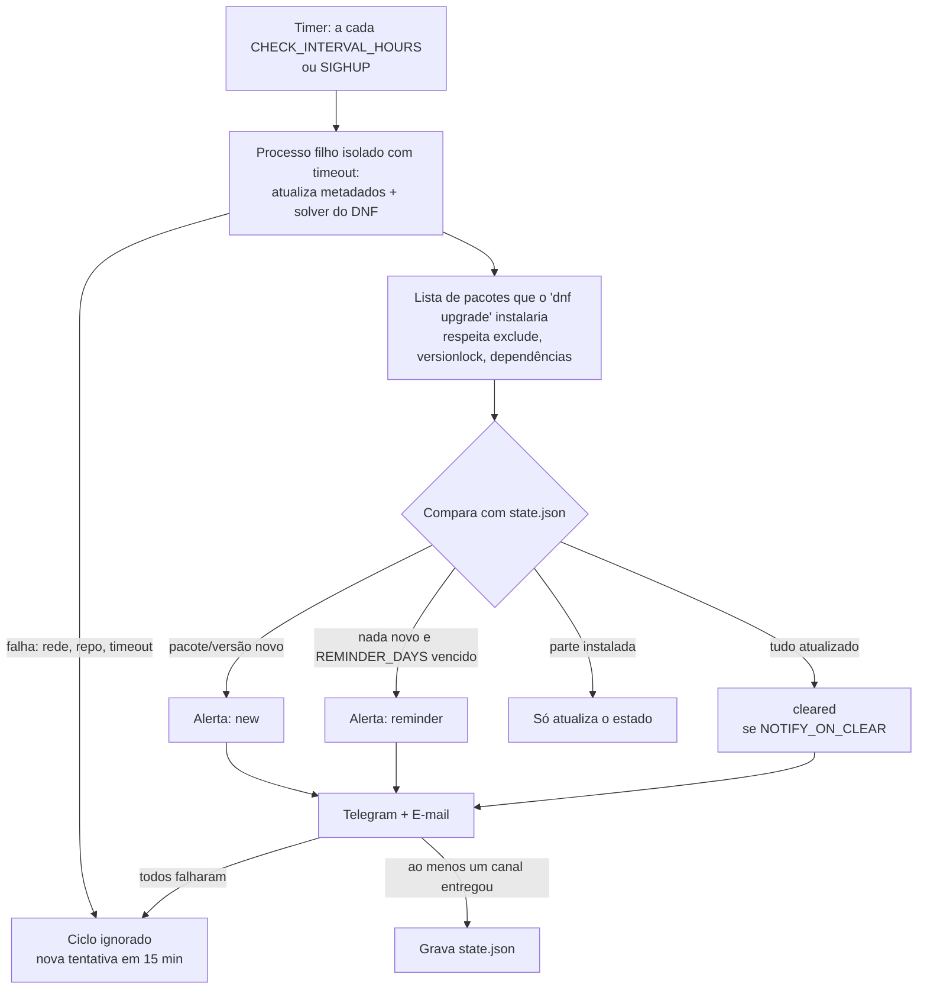

# Como funciona

## Visão geral

## O que conta como "atualização pendente"

O daemon monta uma transação de verdade com a API do DNF — `upgrade_all()` + `resolve()` — com `best=False` e
`strict=False`, ou seja, o equivalente a `dnf upgrade --nobest --skip-broken` **sem instalar nada**. Por isso:

* pacotes impedidos por dependências quebradas **não** aparecem (diferente de `dnf check-update`, que lista tudo);
* `exclude=` do `dnf.conf` e o plugin `versionlock` são respeitados — o daemon carrega os plugins do DNF como o
  comando `dnf` faz (a API do DNF não faz isso sozinha; desligue com `LOAD_DNF_PLUGINS=false`);
* kernels (que são *installonly*) aparecem — a API os coloca em `install_set`, não como "upgrade";
* se o solver falhar de forma inesperada, o daemon cai para a lista simples de upgrades e registra um aviso.

A consulta roda em um **processo filho** (`dnf-monitor --collect-json`, uso interno): a libdnf acumula memória em
processos longos e o DNF pode travar em mirrors lentos, então o pai impõe um timeout
(`COLLECT_TIMEOUT_MINUTES`, padrão 15) e permanece leve.

Se `UPDATE_CACHE=true`, cada ciclo força a renovação dos metadados (`metadata_expire=0`, como
`dnf makecache --refresh`). Com `SKIP_BROKEN_REPOS=true` (padrão), um repositório fora do ar não impede o
monitoramento dos demais.

## Decisão de alertas

O estado guarda o conjunto `nome=versão` já notificado, o instante do último alerta e se o aviso de reboot já saiu.

| Situação | Resultado |
|---|---|
| Surgiu pacote ou versão que não estava no estado | **Alerta** (`new`) com a lista completa pendente |
| Mesma lista, `REMINDER_DAYS` vencido | **Lembrete** (`reminder`) |
| Lista encolheu (você instalou parte) | Silencioso; só atualiza o estado |
| Lista vazia, antes havia pendência | `Servidor em dia` se `NOTIFY_ON_CLEAR=true` |
| `needs-restarting -r` passou a indicar reboot | Alerta de **reinicialização** (uma vez por ocorrência) |
| O DNF falhou (rede, repositório, lock, timeout) | Ciclo ignorado — **não** conta como "tudo atualizado" |
| Nenhum canal conseguiu entregar | Estado **não** é gravado; nova tentativa em até 15 min |

Por isso `restart`, reboot, upgrade do pacote e rotação de log não geram alertas repetidos.

## Classificação

* **Kernel (crítico 🚨):** `kernel`, `kernel-core`, `kernel-modules`, `kernel-modules-core`, `kernel-modules-extra`
  e as variantes `kernel-uek*` (Oracle), `kernel-rt*`, `kernel-64k*`, `kernel-debug*`. *Não* inclui
  `kernel-headers`, `kernel-devel`, `kernel-tools`, `kernel-doc` nem `linux-firmware`.
* **Segurança 🔐:** o pacote tem upgrade ligado a um *advisory* do tipo `security` no `updateinfo` dos repositórios
  (RHEL, Rocky, Alma e Oracle publicam; repositórios sem `updateinfo` simplesmente não marcam segurança).
* **Reboot 🔁:** vem de `needs-restarting -r` (pacote `dnf-utils`, recomendado). Sem ele, o aviso de reboot fica
  desativado.

## Arquivos

| Caminho | Função |
|---|---|
| `/usr/libexec/dnf-monitor/dnf_monitor.py` | o daemon (também disponível como `/usr/sbin/dnf-monitor`) |
| `/etc/dnf-monitor/dnf-monitor.conf` | configuração (`0600`, contém credenciais) |
| `/var/lib/dnf-monitor/state.json` | estado (o que já foi notificado) |
| `/var/log/dnf-monitor.log` | log próprio, rotação semanal sem reiniciar o serviço |
| `/usr/lib/systemd/system/dnf-monitor.service` | unit do systemd |
| `/etc/logrotate.d/dnf-monitor` | rotação do log |

## Sinais e códigos de saída

| | |
|---|---|
| `SIGHUP` (`systemctl reload`) | recarrega a configuração e executa um ciclo imediatamente; configuração inválida é recusada e a anterior é mantida |
| `SIGTERM`/`SIGINT` | encerra limpo (código 0) |
| Código `78` | configuração inválida; o systemd **não** reinicia (`RestartPreventExitStatus=78`) |
| Código `1` (`--once`/`--test-notify`) | nenhum canal entregou, ou o DNF falhou |

## Segurança

* O serviço roda como root (o DNF exige), mas com `NoNewPrivileges`, `ProtectSystem=strict` (escrita só em
  `/var/lib/dnf`, `/var/cache/dnf`, `/var/lib/rpm`, `/var/log` e `/var/lib/dnf-monitor`), `ProtectHome`, `PrivateTmp`,
  `PrivateDevices`, `RestrictAddressFamilies`, `RestrictNamespaces` e outros.
* Token do Telegram e senha SMTP são removidos de qualquer mensagem de log, inclusive de erros de rede.
* Credenciais SMTP só trafegam sob TLS (a menos que você force `SMTP_SECURITY=none`).
* Todo texto dinâmico (hostname, nomes de pacote) é escapado em HTML.
* Verifique a exposição do unit com `systemd-analyze security dnf-monitor`.
* O daemon **não instala nada**: só consulta e avisa.

## Estrutura do código

`src/dnf_monitor.py` (biblioteca padrão + `python3-dnf`, compatível com Python ≥ 3.6):

* `load_config` / `Config` — leitura e validação do `.conf`;
* `collect_updates` (pai) e `_collect_in_process` (filho), `reboot_required`, `get_machine_ips` — informações do sistema;
* `Alert` — conteúdo das mensagens (Telegram HTML, e-mail HTML e texto);
* `TelegramNotifier`, `EmailNotifier` — canais; qualquer classe com `name` e `send(alert) -> bool` vira um canal;
* `State`, `decide`, `Monitor` — lógica de estado e decisão (testável sem rede nem DNF);
* `Daemon`, `main` — loop, sinais e CLI.
