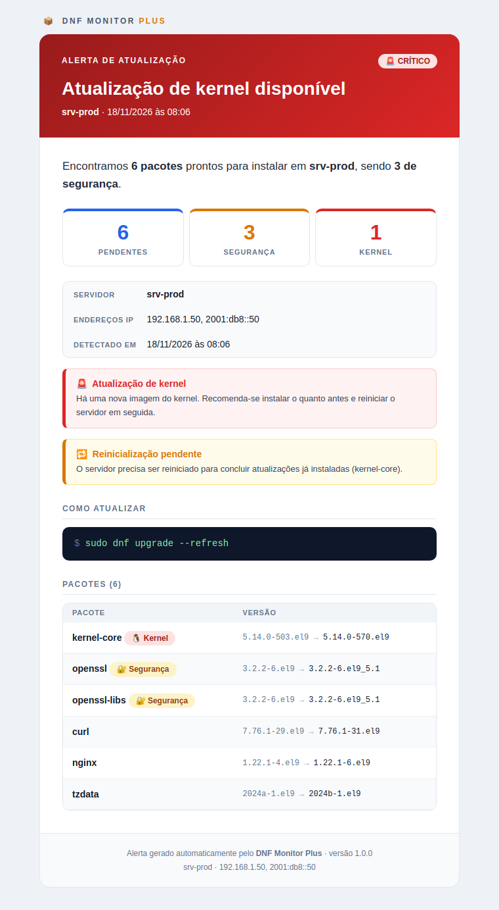
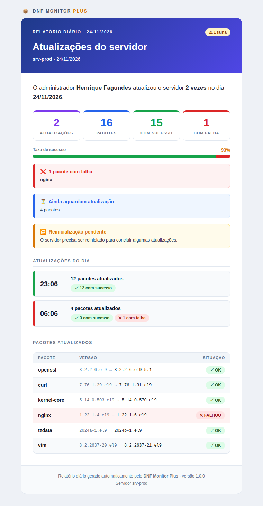
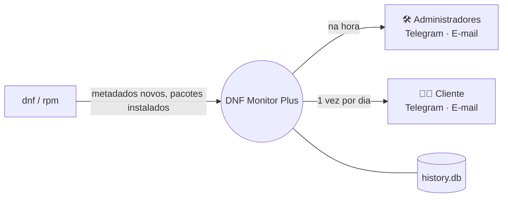

<div align="center">

# 📦 DNF Monitor **Plus**

**Alertas imediatos para os administradores. Prestação de contas diária para o cliente.**

[](https://github.com/AprendendoLinux/dnf-monitor/actions/workflows/ci.yml)
[](https://github.com/AprendendoLinux/dnf-monitor/releases?q=plus-v)


[](../LICENSE)

</div>

O **DNF Monitor Plus** é a edição completa do [DNF Monitor](../README.md): um daemon leve para servidores
RHEL e derivados (Rocky, AlmaLinux, Oracle Linux, CentOS Stream) que faz **duas coisas** para dois públicos diferentes.

| Para quem | O que recebe | Quando |
|---|---|---|
| 🛠️ **Administradores** | **Alerta de atualização disponível**, por Telegram e/ou e-mail: destaca **kernel** e **segurança** e avisa quando é preciso **reiniciar** | **Na hora** (cerca de 1 minuto depois que o DNF detecta) |
| 🧑‍💼 **Cliente** | **Relatório diário** do trabalho feito: quantas vezes o administrador atualizou o servidor e o total de pacotes (**com sucesso** e **com falha**). Se algo fica pendente há mais de 3 dias, avisa e sugere falar com o administrador | **Uma vez por dia**, no horário que você definir |

| 📨 Alerta aos administradores | 📋 Relatório ao cliente |
|---|---|
|  |  |

## Índice

- [Clássico ou Plus?](#clássico-ou-plus)
- [Recursos](#recursos)
- [Como funciona](#como-funciona)
- [Instalação](#instalação)
- [Início rápido](#início-rápido)
- [Configuração](#configuração)
- [Uso](#uso)
- [O relatório do cliente](#o-relatório-do-cliente)
- [Segurança e privacidade](#segurança-e-privacidade)
- [Compatibilidade](#compatibilidade)
- [Perguntas frequentes](#perguntas-frequentes)
- [Documentação](#documentação)
- [Desenvolvimento](#desenvolvimento)

## Clássico ou Plus?

| | **Clássico** | **Plus** |
|---|---|---|
| Alertas aos administradores (Telegram e e-mail) | ✅ | ✅ |
| Destaque de kernel, segurança e reinício pendente | ✅ | ✅ |
| **Alerta imediato** quando o DNF muda (≈ 1 min) | — | ✅ |
| **E-mails novos** (cabeçalho por gravidade, cartões, selos, celular) | — | ✅ |
| **Relatório diário ao cliente** (Telegram e/ou e-mail) | — | ✅ |
| **Aviso de pendência antiga** ao cliente | — | ✅ |
| **Histórico** do que foi atualizado, com sucesso/falha por pacote | — | ✅ (SQLite) |
| Dependências | `python3-dnf` | `python3-dnf` + `tzdata` |

**Escolha o Plus** se você presta serviço a alguém (cliente, chefia, outra equipe) e quer **mostrar o trabalho feito**
de forma automática, ou se quer os alertas mais rápidos e mais claros. **Fique no clássico** se só precisa do alerta
simples. O Plus **substitui** o clássico: veja a [migração](docs/migracao.md), que preserva a sua configuração.

## Recursos

| | |
|---|---|
| ⚡ **Alerta imediato** | Reage em cerca de 1 minuto quando o DNF baixa metadados novos ou instala pacotes, sem esperar o intervalo. |
| 🚨 **Kernel crítico** | Só imagens de kernel e metapacotes disparam o crítico; `linux-headers` e `linux-firmware` não. |
| 🔐 **Segurança** | Atualizações de repositórios `*-security` são destacadas e contadas. |
| 🔁 **Reinício pendente** | Avisa quando existe `/var/run/reboot-required`. |
| 📋 **Relatório diário** | Quantas vezes o administrador atualizou e quantos pacotes (sucesso/falha), por Telegram e/ou e-mail. |
| ✅ **Sucesso real, pacote a pacote** | Usa o histórico de transações do próprio DNF: sabe o que foi atualizado e o resultado de cada pacote. |
| ⏳ **Pendência antiga** | Mais de N dias parado? O cliente recebe a lista completa e a sugestão de falar com o administrador. |
| 🙋 **Nome do administrador** | `ADMIN_NAME`: "O administrador Fulano atualizou o servidor…". Em branco: "A equipe técnica". |
| 🤖 **Sem trabalho extra** | Detecta sozinho o que você atualiza; ignora o `dnf-automatic`. |
| 🔕 **Sem repetição** | O estado fica em disco. Reiniciar o serviço ou o servidor não reenvia alertas. |
| 🌎 **Fuso e horário configuráveis** | Padrão: 22:30, `America/Sao_Paulo`. |
| 🛡️ **Resiliente** | Timeouts, novas tentativas, falha em um canal não afeta os outros; falha do DNF **não** vira "tudo em dia". |
| 🔒 **Seguro por padrão** | Credenciais fora dos logs, `.conf` e banco com `0600`, serviço com hardening do systemd, SMTP sempre sob TLS. |
| 🪶 **Leve** | Uma dependência (`python3-dnf`) mais `tzdata`; resto é biblioteca padrão (o SQLite já vem no Python). |

## Como funciona



1. O Plus vigia o DNF e avisa **os administradores** assim que há atualização disponível.
2. Quando o administrador atualiza, o Plus lê o histórico de transações do DNF (que já traz o resultado de cada
   pacote) e guarda tudo no histórico dele.
3. Uma vez por dia, no horário configurado, o **cliente** recebe o resumo do que foi feito (e as pendências antigas).

Detalhes técnicos: [Como funciona](docs/arquitetura.md).

## Instalação

### Pelo `.rpm` (recomendado)

Baixe o arquivo mais recente em **[Releases](https://github.com/AprendendoLinux/dnf-monitor/releases?q=plus-v)**
(procure as versões `plus-v…`; há também o `SHA256SUMS`):

```bash
wget https://github.com/AprendendoLinux/dnf-monitor/releases/download/plus-v1.0.0/dnf-monitor-plus-1.0.0-1.noarch.rpm
sha256sum -c SHA256SUMS --ignore-missing          # opcional: confere a integridade
sudo dnf install ./dnf-monitor-plus-1.0.0-1.noarch.rpm
```

O pacote cria `/var/lib/dnf-monitor-plus`, protege o `.conf` (`0600`), configura o `logrotate` e **habilita** o serviço.
Ele só **inicia** quando a configuração é válida; enquanto for o modelo de exemplo, mostra o que falta.

### Já uso o DNF Monitor clássico

Instale o Plus **por cima**: o `dnf` remove o clássico e o instalador **migra a sua configuração e o estado** sozinho.
Veja a [migração](docs/migracao.md).

### Gerando o pacote você mesmo

```bash
git clone https://github.com/AprendendoLinux/dnf-monitor && cd dnf-monitor
plus/build.sh                                  # → plus/dist/dnf-monitor-plus-<versão>-1.noarch.rpm
sudo dnf install ./plus/dist/dnf-monitor-plus-*.noarch.rpm
```

## Início rápido

```bash
# 1. configure os ADMINISTRADORES (Telegram e/ou e-mail)
sudo nano /etc/dnf-monitor-plus/dnf-monitor.conf

# 2. valide (não envia nada) e teste o envio
sudo dnf-monitor-plus --check-config
sudo dnf-monitor-plus --test-notify

# 3. ligue
sudo systemctl restart dnf-monitor-plus

# 4. (opcional) configure o CLIENTE e pré-visualize o relatório
sudo dnf-monitor-plus --report --dry-run
```

O mínimo para funcionar é um canal de administrador:

```ini
[Telegram]
BOT_TOKEN=123456789:AAE-abc...
CHAT_IDS=12345678
```

Passo a passo completo: [Guia de uso](docs/uso.md). Cliente: [Configuração do cliente](docs/cliente.md).

## Configuração

Um único arquivo: **`/etc/dnf-monitor-plus/dnf-monitor.conf`**. Depois de editar:
`sudo systemctl reload dnf-monitor-plus`.

| Seção | Para quê |
|---|---|
| `[Telegram]` | Bot dos **administradores** (token e chats) |
| `[Email]` | E-mail dos **administradores** (SMTP e destinatários) |
| `[Monitor]` | Intervalo de checagem, lembrete, "servidor em dia", metadados, log e estado |
| `[Report]` | Relatório do cliente: `ADMIN_NAME`, `REPORT_TIME`, `REPORT_TIMEZONE`, `PENDING_ALERT_DAYS`, `SEND_EMPTY`, `PACKAGE_LIST`, `DB_FILE` |
| `[ClientTelegram]` | Bot do **cliente** (diferente do dos administradores) |
| `[ClientEmail]` | E-mail do **cliente** (mesmas chaves de `[Email]`) |

Exemplo completo (administradores e cliente, Telegram e e-mail):

```ini
[Telegram]
BOT_TOKEN=123456789:AAE-admin...
CHAT_IDS=12345678

[Email]
SMTP_SERVER=smtp.exemplo.com
SMTP_USER=alerta@exemplo.com
SMTP_PASS=sua-senha
RECIPIENT_EMAILS=admin@exemplo.com

[Report]
ADMIN_NAME=Henrique Fagundes
REPORT_TIME=22:30
REPORT_TIMEZONE=America/Sao_Paulo
PENDING_ALERT_DAYS=3

[ClientTelegram]
BOT_TOKEN=987654321:AAF-cliente...
CHAT_IDS=-1009876543210

[ClientEmail]
SMTP_SERVER=smtp.exemplo.com
SMTP_USER=alerta@exemplo.com
SMTP_PASS=sua-senha
SENDER_NAME=Suporte Técnico
RECIPIENT_EMAILS=responsavel@empresa.com.br
```

📄 **Quer ver um arquivo completo, como fica num servidor de verdade?** Veja o
**[exemplo de configuração completa](docs/exemplo-configuracao.md)** (analista e cliente, Telegram e e-mail, com dados
fictícios).

📖 **Todas as chaves, padrões, valores aceitos, erros e exemplos:**
**[Referência de configuração](docs/configuracao.md)**. O modelo completo e comentado também fica em
`/usr/share/doc/dnf-monitor-plus/examples/dnf-monitor.conf`.

## Uso

| Comando | Função |
|---|---|
| `dnf-monitor-plus --check-config` | Valida a configuração e mostra os canais (admin e cliente). Código 78 se inválida. |
| `dnf-monitor-plus --test-notify` | Envia uma mensagem de teste a cada canal (relatório de exemplo ao cliente). |
| `dnf-monitor-plus --report` | Envia agora o relatório diário ao cliente. |
| `dnf-monitor-plus --report --dry-run` | Mostra o relatório sem enviar. |
| `dnf-monitor-plus --once` | Faz uma checagem de pendências e sai. |
| `dnf-monitor-plus --dry-run` | Mostra os alertas sem enviar nem gravar estado. |
| `dnf-monitor-plus -c ARQUIVO` | Usa outro arquivo de configuração. |
| `dnf-monitor-plus --version` | Mostra a versão. |

O atalho `dnf-monitor` funciona como `dnf-monitor-plus`. Manual: `man dnf-monitor-plus`.

```bash
systemctl status dnf-monitor-plus            # estado do serviço
sudo journalctl -u dnf-monitor-plus -f       # logs
sudo systemctl reload dnf-monitor-plus       # recarrega o .conf e checa na hora
sudo dnf versionlock add <pacote>            # pacotes travados são ignorados
```

Todos os detalhes, um dia típico, catálogo de mensagens, logs e backup: **[Guia de uso](docs/uso.md)**.

## O relatório do cliente

- **Uma mensagem por dia**, a partir de `REPORT_TIME` (padrão **22:30**, fuso **America/Sao_Paulo**).
- Diz quantas vezes o administrador atualizou, o total de pacotes, quantos com **sucesso** e quantos com **falha**.
- **Só conta quando há pacote atualizado**; instalar ou remover pacotes não entra, e o `dnf-automatic` fica de fora.
- **Dia sem novidade, nenhuma mensagem** (ou envie sempre com `SEND_EMPTY=true`).
- **Pendência antiga:** se algum pacote espera há **mais de 3 dias** (`PENDING_ALERT_DAYS`), o relatório lista **todos**
  os pendentes e sugere entrar em contato com o administrador **sem citar nomes**, mesmo em dia sem atualização.
- Cada canal é controlado à parte: se o Telegram entregou e o e-mail falhou, só o e-mail é retentado.

Regras completas: [Relatório diário](docs/relatorio.md). Como configurar: [Configuração do cliente](docs/cliente.md).
Como ficam as mensagens: [Galeria](docs/emails.md).

## Segurança e privacidade

- Token do Telegram e senha SMTP (dos **dois** públicos) são **removidos de qualquer log**, inclusive de erros de rede.
- `/etc/dnf-monitor-plus/dnf-monitor.conf` e o `history.db` ficam com modo **`0600`**.
- Credenciais SMTP só trafegam **sob TLS** (a menos que você force `SMTP_SECURITY=none`).
- Serviço do systemd com `NoNewPrivileges`, `ProtectSystem=strict`, `ProtectHome`, `PrivateTmp`, `PrivateDevices`,
  `RestrictAddressFamilies`, entre outros (`systemd-analyze security dnf-monitor-plus`).
- Todo texto dinâmico é **escapado** (HTML); os e-mails **não carregam imagens externas** (sem rastreamento).
- O **cliente nunca vê** os IPs do servidor nem os alertas dos administradores.

Encontrou uma vulnerabilidade? Veja a [política de segurança](../SECURITY.md).

## Compatibilidade

Testado automaticamente (instalação do `.rpm`, **migração a partir do clássico**, alertas, relatório, restart, purge) em
contêineres, e com **systemd real** em Rocky Linux 9 e AlmaLinux 10:

| Distribuição | Python | Status |
|---|---|---|
| Rocky Linux 8 | 3.6 | ✅ |
| Rocky Linux 9 | 3.9 | ✅ (também com systemd) |
| AlmaLinux 10 | 3.12 | ✅ (também com systemd) |
| Oracle Linux 9 | 3.9 | ✅ |

Os testes unitários foram executados em Python **3.6, 3.8 e 3.12** (o CI roda em 3.8 e 3.12). Derivados (Linux Mint, Raspberry Pi OS, Pop!_OS…) funcionam desde que
tenham `dnf`, `python3-dnf`, `tzdata` e `systemd` (RHEL, CentOS Stream e outros derivados).

## Perguntas frequentes

**Vai atualizar meus pacotes sozinho?** Não. Ele só **avisa** e **registra**. (O máximo que faz no sistema é o
equivalente a `dnf makecache`, e dá para desligar com `UPDATE_CACHE=false`.)

**Os administradores recebem o relatório?** Não. Eles recebem os **alertas** na hora. O relatório é só do cliente.

**Posso usar só Telegram ou só e-mail?** Sim, em cada público: deixe o outro canal vazio.

**Preciso configurar o cliente?** Não. Sem `[ClientTelegram]`/`[ClientEmail]`, o Plus funciona só como alerta para os
administradores, já com a detecção imediata e os e-mails novos.

**Trabalho como root; como o relatório sabe meu nome?** Pela chave `ADMIN_NAME`. O histórico do DNF só guarda o usuário (`root`).

**Funciona com `dnf-automatic`?** Sim. As atualizações automáticas **não** entram no relatório (não são trabalho do
administrador), mas os alertas de pendência funcionam normalmente.

**Quanto tempo leva para o alerta chegar?** Cerca de 1 minuto depois que o DNF termina de baixar os metadados.

**E se o servidor ficar desligado no horário do relatório?** O relatório sai assim que o serviço voltar, no mesmo dia.

**Posso adicionar Discord/Slack/ntfy?** Sim: crie uma classe com `name` e `send(mensagem)`; veja
[a arquitetura](docs/arquitetura.md#estrutura-do-código).

**Dá para voltar ao clássico?** Dá, a qualquer momento: [Migração](docs/migracao.md#voltar-para-o-clássico).

Mais em [Solução de problemas](docs/solucao-de-problemas.md).

## Documentação

| Guia | Para quê |
|---|---|
| [Guia de uso](docs/uso.md) | Instalar, ligar, testar, comandos, um dia típico, mensagens, logs, backup |
| [Referência de configuração](docs/configuracao.md) | **Todas as chaves**, padrões, erros e exemplos prontos |
| [Exemplo de configuração completa](docs/exemplo-configuracao.md) | Um `.conf` real de produção (dados fictícios): analista e cliente, Telegram e e-mail |
| [Configuração do cliente](docs/cliente.md) | Segundo bot, grupo, e-mail, nome do administrador, testes |
| [Relatório diário](docs/relatorio.md) | Regras: o que conta, quando sai, pendências antigas, casos de borda |
| [Galeria de mensagens](docs/emails.md) | Capturas dos e-mails (desktop e celular) |
| [Migração do clássico](docs/migracao.md) | Trocar o clássico pelo Plus, conferir e voltar atrás |
| [Como funciona](docs/arquitetura.md) | Fluxos, banco de dados, tempos, segurança, código |
| [Solução de problemas](docs/solucao-de-problemas.md) | Diagnóstico passo a passo |
| [Criar o bot do Telegram](../docs/telegram.md) · [Configurar o SMTP](../docs/email.md) | Guias compartilhados com o clássico |
| [Changelog do Plus](CHANGELOG.md) | Histórico de versões |

## Desenvolvimento

```bash
python3 -m unittest discover -s plus/tests -v   # unitários (segundos)
plus/build.sh                                    # gera plus/dist/dnf-monitor-plus-<versão>-1.noarch.rpm
plus/tests/docker/run-matrix.sh [imagem...]      # instala o .rpm em contêineres RHEL (Rocky, Alma, Oracle), inclusive a migração
plus/tests/docker/systemd-test.sh [imagem...]    # idem, com systemd real
plus/tests/render/run.sh                         # renderiza os e-mails num Chromium (contêiner) e salva capturas
```

Veja o [guia de contribuição](../CONTRIBUTING.md).

## Licença

[MIT](../LICENSE).
