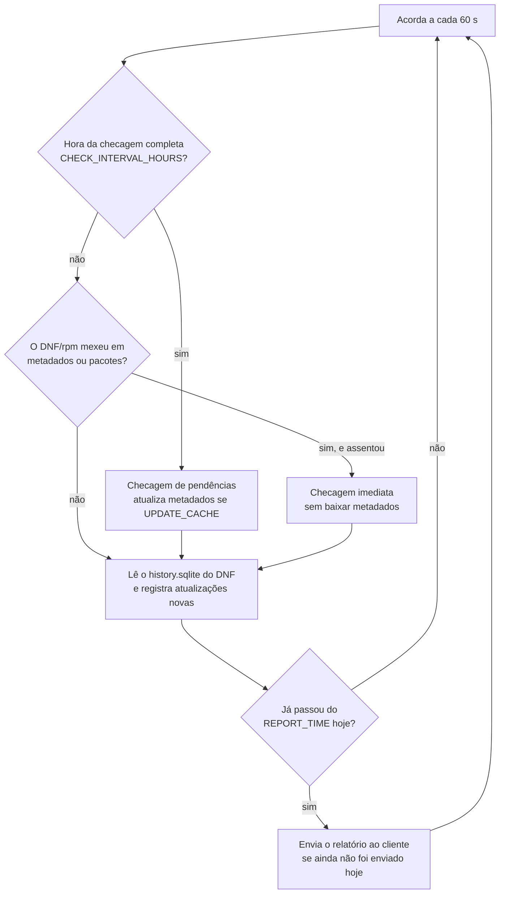
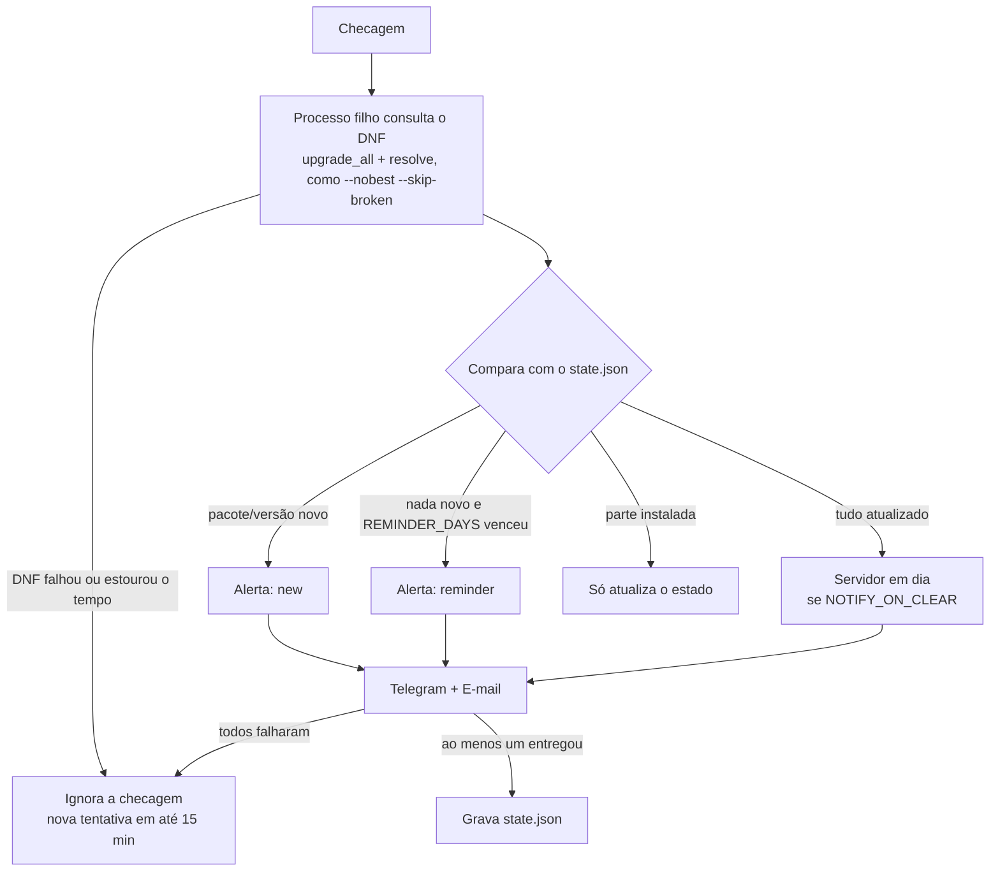
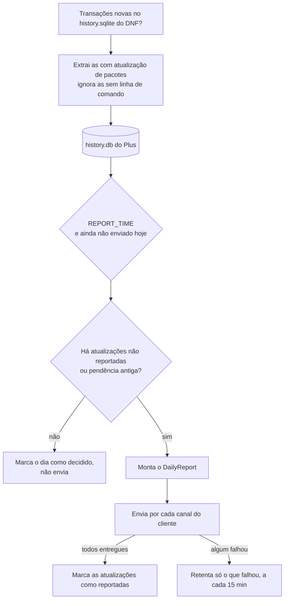

# Como funciona (arquitetura)

Visão técnica do DNF Monitor Plus: fluxos, estado, banco de dados, tempos e segurança.

## Índice

- [Visão geral](#visão-geral)
- [Dois fluxos independentes](#dois-fluxos-independentes)
- [Alertas aos administradores](#alertas-aos-administradores)
- [Histórico e relatório ao cliente](#histórico-e-relatório-ao-cliente)
- [Banco de dados](#banco-de-dados)
- [Tempos e constantes](#tempos-e-constantes)
- [Arquivos](#arquivos)
- [Sinais e códigos de saída](#sinais-e-códigos-de-saída)
- [Segurança](#segurança)
- [Estrutura do código](#estrutura-do-código)

## Visão geral

Um único processo Python (daemon do systemd, biblioteca padrão + `python3-dnf`, compatível com Python ≥ 3.6) com um
laço que **acorda a cada 60 segundos** e faz três coisas, todas baratas:

## Dois fluxos independentes

| | Alertas (administradores) | Relatório (cliente) |
|---|---|---|
| Insumo | Pacotes **pendentes** (solver do DNF) | O que foi **feito** (`history.sqlite` do DNF) |
| Memória | `state.json` (o que já foi avisado) | `history.db` (SQLite do Plus) |
| Quando | Na hora: intervalo **e** mudança do DNF/rpm | Uma vez por dia, em `REPORT_TIME` |
| Canais | `[Telegram]`, `[Email]` | `[ClientTelegram]`, `[ClientEmail]` |

Os dois fluxos **não se misturam**: um bot do cliente nunca recebe um alerta, e os administradores nunca recebem o
relatório.

## Alertas aos administradores

- **Coletor em processo filho.** A consulta ao DNF roda num processo separado (`--collect-json`), porque a libdnf acumula
  memória e o DNF pode travar com mirrors lentos; assim o daemon fica isolado e há um tempo máximo
  (`COLLECT_TIMEOUT_MINUTES`). O filho devolve o resultado em JSON numa linha marcada.
- **Solver do DNF.** O coletor usa `base.upgrade_all()` + `base.resolve()`, como o `dnf upgrade --nobest --skip-broken`:
  pacote com dependência quebrada, em `exclude` ou travado por `versionlock` **não** conta como pendente. Os plugins do
  DNF são carregados (`LOAD_DNF_PLUGINS`) para o `versionlock` valer.
- **Classificação.** *Kernel* (crítico): `kernel`, `kernel-core`, `kernel-modules*`, `kernel-uek*`, `kernel-rt*`,
  `kernel-64k*`, `kernel-debug*`; **não** `kernel-headers`, `kernel-devel`, `kernel-tools` e afins. *Segurança*: o pacote
  tem advisory do tipo `security` no `updateinfo`.
- **Reinício.** `needs-restarting -r` (pacote `dnf-utils` / `dnf-plugins-core`).
- **Detecção imediata.** O laço guarda a data de modificação dos arquivos que o DNF e o rpm mexem:
  `/var/cache/dnf/*/repodata/repomd.xml` (metadados dos repositórios) e o banco do rpm (`/var/lib/rpm/rpmdb.sqlite` e
  seu `-wal` no EL9/EL10; `/var/lib/rpm/Packages` no EL8). Quando mudam e ficam **20 s parados**, ele refaz a checagem
  **sem** baixar os metadados de novo. A atualização que o próprio Plus faz **não** conta como novidade (senão haveria um
  laço). Os arquivos `-shm` ficam de fora de propósito: eles mudam até em leituras.
- **Entrega.** Telegram: 3 tentativas por chat, com espera crescente e respeito ao `retry_after` do 429. SMTP: uma
  conexão, uma mensagem por destinatário; um destinatário ruim não derruba os demais. Se **nenhum** canal entregar, o
  estado não é gravado e o alerta é retentado em até 15 min.

## Histórico e relatório ao cliente

- **Leitura do DNF.** `/var/lib/dnf/history.sqlite`, aberto em modo somente leitura. A consulta pega as transações com
  `dt_begin` posterior à criação do banco do Plus. O esquema (tabelas `trans`, `trans_item` e `rpm`) e os códigos de
  ação são os mesmos no EL8, EL9 e EL10 (conferido em Rocky, AlmaLinux e Oracle Linux):

  | Código | Significado |
  |---|---|
  | `ação 1` | Instalação (usada também para o kernel novo, que é *installonly*) |
  | `ação 6` | Pacote novo de uma atualização (*Upgrade*) |
  | `ação 7` | Pacote antigo, substituído por uma atualização (*Upgraded*) |
  | `estado 1` | Concluído |

- **Sem linha de comando = automática.** `cmdline` vazio identifica transações feitas pela API do DNF
  (`dnf-automatic`, PackageKit…); elas são descartadas. Transações com `dnf-automatic` na linha também.
- **Sucesso por pacote.** O estado de cada item da transação vem do próprio DNF; transação com erro, ou que nunca
  terminou (6 h), marca todos os pacotes como falha.
- **Pendências.** A cada checagem, o Plus espelha a lista de pendentes na tabela `pending`, guardando `first_seen`
  (quando foi visto pela primeira vez). Ao gerar o relatório, se algum pendente tem
  `agora − first_seen > PENDING_ALERT_DAYS`, **todos** entram no relatório.
- **Fuso sem `zoneinfo`.** O horário e a data do relatório usam o fuso configurado trocando temporariamente `TZ` do
  processo (funciona em Python 3.6+). O nome do fuso é validado contra `/usr/share/zoneinfo` (pacote `tzdata`).

## Banco de dados

`/var/lib/dnf-monitor-plus/history.db` (SQLite, modo `0600`). Criado na primeira execução; só registra o que acontece
**depois** dessa criação.

| Tabela | Conteúdo |
|---|---|
| `meta` | `since_ts`: instante da criação do banco (nada anterior é importado) |
| `runs` | Uma linha por atualização: início, fim, comando, `ok`, `failed`, `reported_day`. Única por `(início, comando)` |
| `run_packages` | Os pacotes de cada atualização: nome, versão antiga, versão nova, `ok` |
| `pending` | Pacotes pendentes agora: nome, versões, segurança e `first_seen` |
| `daily_reports` | `(dia, canal)` já resolvidos (enviado ou, `skipped`, sem nada a enviar) |

## Tempos e constantes

| Constante | Valor | Para quê |
|---|---|---|
| `POLL_INTERVAL` | 60 s | Intervalo do laço (histórico do DNF, horário do relatório, mudanças do DNF/rpm) |
| `REPO_SETTLE` | 20 s | Quanto o DNF/rpm precisa ficar quieto antes da checagem imediata |
| `RETRY_INTERVAL` | 15 min | Nova tentativa após falha de entrega ou do DNF |
| `INPROGRESS_GRACE` | 6 h | Tolerância para uma transação do DNF ainda em andamento |
| `CHECK_INTERVAL_HOURS` | 4 h (configurável) | Checagem completa de segurança |
| `COLLECT_TIMEOUT_MINUTES` | 15 min (configurável) | Tempo máximo da consulta ao DNF |

## Arquivos

| Caminho | Função |
|---|---|
| `/usr/libexec/dnf-monitor-plus/dnf_monitor.py` | O daemon (também `/usr/sbin/dnf-monitor-plus` e o atalho `/usr/sbin/dnf-monitor`) |
| `/etc/dnf-monitor-plus/dnf-monitor.conf` | Configuração (`0600`, contém credenciais) |
| `/var/lib/dnf-monitor-plus/state.json` | O que já foi avisado aos administradores |
| `/var/lib/dnf-monitor-plus/history.db` | Histórico, pendências e relatórios enviados |
| `/var/log/dnf-monitor-plus.log` | Log próprio (rotação semanal, sem reiniciar o serviço) |
| `/usr/lib/systemd/system/dnf-monitor-plus.service` | Unit do systemd |
| `/etc/logrotate.d/dnf-monitor-plus` | Rotação do log |
| `/usr/share/doc/dnf-monitor-plus/` | README, esta documentação e `examples/dnf-monitor.conf` |

## Sinais e códigos de saída

| | |
|---|---|
| `SIGHUP` (`systemctl reload`) | Recarrega a configuração e checa na hora; configuração inválida é recusada e a anterior é mantida |
| `SIGTERM`/`SIGINT` | Encerra limpo (código 0) |
| Código `78` | Configuração inválida; o systemd **não** reinicia (`RestartPreventExitStatus=78`) |
| Código `1` (`--once`/`--test-notify`/`--report`) | Nenhum canal entregou |

## Segurança

- O serviço roda como root (o DNF exige para atualizar metadados), mas com `NoNewPrivileges`, `ProtectSystem=strict`
  (escrita só em `/var/lib/dnf`, `/var/cache/dnf`, `/var/lib/rpm`, `/var/log` e `/var/lib/dnf-monitor-plus`),
  `ProtectHome`, `PrivateTmp`, `PrivateDevices`, `RestrictAddressFamilies`, `RestrictNamespaces` e outros. Verifique a
  exposição com `systemd-analyze security dnf-monitor-plus`.
- **Token do Telegram e senha SMTP** (dos dois públicos) são removidos de qualquer mensagem de log, inclusive de erros
  de rede.
- O `.conf` e o `history.db` ficam com modo **0600**; o `history.sqlite` do DNF é aberto **somente leitura**.
- Credenciais SMTP só trafegam **sob TLS** (a menos que você force `SMTP_SECURITY=none`).
- **Todo texto dinâmico** (hostname, nomes de pacote, `ADMIN_NAME`) é escapado em HTML, evitando injeção.
- Os e-mails **não carregam imagens nem recursos externos**: nada é baixado quando o cliente abre a mensagem (sem
  rastreamento).
- O cliente nunca recebe IPs nem alertas dos administradores (veja [Dados e privacidade](relatorio.md#dados-e-privacidade)).

## Estrutura do código

`plus/src/dnf_monitor.py`:

- `load_config` / `Config` / `_parse_email` — leitura e validação do `.conf`.
- `collect_updates` (processo pai), `_collect_in_process` / `collect_main` (processo filho), `reboot_required`,
  `get_machine_ips` — informações do sistema.
- `read_dnf_history`, `repo_signature`, `repo_changed`, `HistoryDB` — leitura do histórico do DNF, detecção de mudança e o
  banco SQLite do Plus.
- `timezone`, `report_due`, `next_report_ts` — fuso do relatório.
- `Alert` (alertas dos administradores) e `DailyReport` (relatório do cliente) — conteúdo das mensagens (Telegram HTML,
  e-mail HTML e texto). Compartilham a mesma interface (`subject`, `telegram_text`, `email_text`, `email_html`).
- `TelegramNotifier`, `EmailNotifier` — canais; qualquer classe com `name` e `send(mensagem) -> bool` vira um canal.
- `State`, `decide`, `Monitor` — lógica de estado, decisão, ingestão do histórico e relatório (testável sem rede nem DNF).
- `Daemon`, `main` — laço, sinais e CLI.
