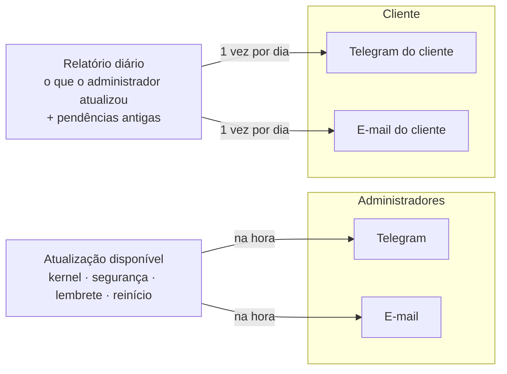

# Referência de configuração

Tudo o que o DNF Monitor Plus faz é controlado por **um arquivo**:

```
/etc/dnf-monitor-plus/dnf-monitor.conf
```

Este guia explica **cada chave**: o que faz, o valor padrão, o que é aceito e o que acontece se estiver errado.
Para um passo a passo guiado, veja o [Guia de uso](uso.md) e a [Configuração do cliente](cliente.md).

## Índice

- [Como editar e aplicar](#como-editar-e-aplicar)
- [Regras do arquivo](#regras-do-arquivo)
- [Quem recebe o quê](#quem-recebe-o-quê)
- [`[Telegram]` — bot dos administradores](#telegram--bot-dos-administradores)
- [`[Monitor]` — como e quando verificar](#monitor--como-e-quando-verificar)
- [`[Email]` — e-mail dos administradores](#email--e-mail-dos-administradores)
- [`[Report]` — o relatório diário do cliente](#report--o-relatório-diário-do-cliente)
- [`[ClientTelegram]` — bot do cliente](#clienttelegram--bot-do-cliente)
- [`[ClientEmail]` — e-mail do cliente](#clientemail--e-mail-do-cliente)
- [Exemplos prontos](#exemplos-prontos)
- [Validação e mensagens de erro](#validação-e-mensagens-de-erro)
- [Tabela-resumo de todas as chaves](#tabela-resumo-de-todas-as-chaves)

---

## Como editar e aplicar

```bash
sudo nano /etc/dnf-monitor-plus/dnf-monitor.conf     # edite
sudo dnf-monitor-plus --check-config                 # valide (não envia nada)
sudo dnf-monitor-plus --test-notify                  # teste o envio de verdade
sudo systemctl reload dnf-monitor-plus               # aplique, sem derrubar o serviço
```

| Ação | Quando usar |
|---|---|
| `systemctl reload dnf-monitor-plus` | Depois de **qualquer** edição do `.conf`. Recarrega a configuração e faz uma checagem imediata. Se o arquivo novo estiver inválido, ele é **recusado** e a configuração anterior continua valendo (veja o log). |
| `systemctl restart dnf-monitor-plus` | Equivale ao `reload`, mas reinicia o processo. Use se o serviço estiver parado. |

> O comando `dnf-monitor` também funciona: é um atalho para `dnf-monitor-plus`.

## Regras do arquivo

- **Formato INI**: seções entre colchetes (`[Telegram]`) e linhas `CHAVE=valor`. Os nomes das **seções** diferenciam
  maiúsculas de minúsculas (escreva exatamente `[ClientEmail]`, não `[clientemail]`); os das chaves não, mas use
  sempre MAIÚSCULAS, como nos exemplos.
- **Seções repetidas são mescladas.** Se `[Report]` aparecer duas vezes (por exemplo, o `.conf` migrado já traz o
  cabeçalho vazio e você cola outro bloco preenchido), o Plus junta as duas; se a mesma chave aparecer duas vezes,
  **vale a última**. Mesmo assim, o jeito mais limpo é descomentar e preencher as linhas no lugar.
- **Comentários** começam com `#` ou `;`, no início da linha **ou no fim dela**, depois de um espaço:
  `SMTP_PORT=587   # STARTTLS`.
- **Listas** (`CHAT_IDS`, `RECIPIENT_EMAILS`, `IGNORE_INTERFACES`) são separadas por **vírgula**; os espaços ao redor
  são ignorados.
- **Verdadeiro/falso**: `true`, `yes`, `sim`, `on` e `1` valem como verdadeiro. Qualquer outra coisa vale como falso.
- **Senhas com `%`** funcionam normalmente (não há interpolação).
- **Valores de exemplo contam como "não configurado"**: `seu_bot_token_aqui`, `sua_senha_segura` e qualquer valor
  com `seuservidor` (como `smtp.seuservidor.com`). O arquivo vem assim de propósito: nada é enviado até você preencher.
- **Segurança**: o arquivo guarda o token do bot e a senha do SMTP. Ele é instalado com modo **`0600`** (só o `root`
  lê). Não mude isso. Token e senha **nunca** aparecem nos logs.

## Quem recebe o quê



| Público | Seções | Recebe | Quando |
|---|---|---|---|
| **Administradores** | `[Telegram]` e `[Email]` | Alertas: atualização disponível, kernel, segurança, lembrete, "servidor em dia", reinício pendente. **Nenhum relatório.** | Na hora (~1 minuto depois que o DNF detecta) |
| **Cliente** | `[ClientTelegram]` e `[ClientEmail]` | **Somente** o relatório diário | Uma vez por dia, em `REPORT_TIME` |

**Pelo menos um canal de administrador é obrigatório.** Os canais do cliente são opcionais: sem eles, o Plus funciona
só como alerta para os administradores.

---

## `[Telegram]` — bot dos administradores

Alertas por Telegram para quem cuida do servidor.

| Chave | Obrigatória | Padrão | Descrição |
|---|---|---|---|
| `BOT_TOKEN` | para ativar | — | Token do bot, criado no [@BotFather](https://t.me/BotFather). Aceita com ou sem o prefixo `bot`. Em branco, ou um valor de exemplo, **desativa** o Telegram. |
| `CHAT_IDS` | para ativar | — | IDs dos chats que recebem os alertas, separados por vírgula. Conversa privada: ID positivo. Grupo: ID **negativo** (supergrupos: `-100…`). |
| `API_BASE` | não | `https://api.telegram.org` | Endereço da Bot API. Só mude se usar uma Bot API própria. |

```ini
[Telegram]
BOT_TOKEN=123456789:AAE-abc...
CHAT_IDS=12345678, -1001234567890
```

- O Telegram só fica ativo se `BOT_TOKEN` **e** `CHAT_IDS` estiverem preenchidos com valores reais.
- **Um chat que falha não atrapalha os outros.** Se um ID estiver errado, os demais recebem normalmente (e o erro vai
  para o log).
- Como criar o bot e descobrir o `chat_id`: [guia do Telegram](../../docs/telegram.md).

## `[Monitor]` — como e quando verificar

| Chave | Padrão | Descrição |
|---|---|---|
| `CHECK_INTERVAL_HOURS` | `4` | Intervalo entre as verificações completas, em **horas**. Aceita decimais (`0.5` = 30 min). Mínimo efetivo: 1 minuto. Deve ser maior que zero. |
| `REMINDER_DAYS` | `0` | Repete o alerta a cada N dias **enquanto houver pendências** que já foram avisadas. `0` = nunca repete. Aceita decimais. |
| `NOTIFY_ON_CLEAR` | `false` | Se `true`, avisa os administradores quando todas as atualizações forem instaladas ("Servidor em dia"). |
| `UPDATE_CACHE` | `true` | Se `true`, a cada verificação atualiza os metadados dos repositórios, como `dnf makecache --refresh` (exige root). Use `false` para confiar só no cache existente (por exemplo, com o `dnf-makecache.timer`). |
| `SKIP_BROKEN_REPOS` | `true` | Se `true`, um repositório fora do ar não impede o monitoramento dos demais. |
| `LOAD_DNF_PLUGINS` | `true` | Se `true`, carrega os plugins do DNF (`versionlock` etc.), como o comando `dnf` faz; sem isso, pacotes travados gerariam alertas para sempre. |
| `COLLECT_TIMEOUT_MINUTES` | `15` | Tempo máximo da consulta ao DNF, em minutos (mínimo `0.5`). Se estourar, a verificação é abortada e repetida em até 15 min. |
| `IGNORE_INTERFACES` | `lo,docker*,br-*,veth*,virbr*,cni*,flannel*,cali*,tun*,tap*,podman*` | Interfaces de rede que **não** entram na lista de IPs dos alertas. Aceita curingas `*` e `?`. |
| `LOG_FILE` | `/var/log/dnf-monitor-plus.log` | Arquivo de log. **Em branco** = só saída padrão/journal. |
| `STATE_FILE` | `/var/lib/dnf-monitor-plus/state.json` | Guarda "o que já foi avisado", para reinício ou reboot não repetir alertas. |

### Como a detecção funciona (e por que o alerta é "imediato")

Além do intervalo `CHECK_INTERVAL_HOURS`, o Plus **observa o DNF**: quando os metadados dos repositórios mudam (por exemplo,
o `dnf-makecache.timer` baixou metadados novos) ou quando pacotes são instalados (o banco do rpm muda), ele refaz a checagem
**sozinho, em cerca de um minuto**, sem esperar o intervalo e sem baixar os metadados de novo. Por isso o intervalo é só uma rede de segurança;
`4` horas é um bom valor.

### O que dispara um alerta

O Plus guarda o conjunto `pacote=versão` já avisado e só alerta quando **surge algo novo**:

| Situação | Resultado |
|---|---|
| Surgiu pacote ou versão que ainda não foi avisado | **Alerta** com a lista completa de pendentes |
| Mesma lista, e `REMINDER_DAYS` venceu | **Lembrete** |
| A lista só encolheu (o administrador instalou parte) | Silêncio; só atualiza o estado |
| A lista zerou | "Servidor em dia", se `NOTIFY_ON_CLEAR=true` |
| Apareceu `/var/run/reboot-required` | Alerta de **reinicialização**, uma vez por ocorrência |
| O DNF falhou (rede, repositório, tempo esgotado) | Verificação ignorada: **nunca** vira "tudo em dia" |
| Nenhum canal conseguiu entregar | O estado **não** é gravado; nova tentativa em até 15 min |

Pacotes retidos por `exclude`, `versionlock` ou por dependências quebradas são ignorados (o monitor usa o solver do DNF, como o `dnf upgrade --skip-broken`). Reiniciar o serviço, o servidor ou atualizar o próprio Plus **não** gera
alerta repetido.

## `[Email]` — e-mail dos administradores

Alertas por e-mail (HTML e texto puro) para quem cuida do servidor.

| Chave | Obrigatória | Padrão | Descrição |
|---|---|---|---|
| `SMTP_SERVER` | para ativar | — | Servidor SMTP. Em branco, ou valor de exemplo, **desativa** o e-mail. |
| `SMTP_PORT` | não | `587` | Porta: `587` (STARTTLS), `465` (SSL), `25` ou `2525` (relay). |
| `SMTP_SECURITY` | não | `auto` | `auto`, `ssl`, `starttls` ou `none` (veja abaixo). |
| `SMTP_USER` | não | — | Usuário. **Em branco** = sem autenticação (relay local confiável). |
| `SMTP_PASS` | se houver usuário | — | Senha. |
| `SENDER_NAME` | não | `DNF Monitor` | Nome exibido como remetente. |
| `SENDER_EMAIL` | não | valor de `SMTP_USER` | Endereço do remetente. Se não houver nem `SENDER_EMAIL` nem `SMTP_USER`, a configuração é recusada. |
| `RECIPIENT_EMAILS` | para ativar | — | Destinatários, separados por vírgula. **Cada um recebe uma mensagem individual.** |

**Modos de `SMTP_SECURITY`:**

| Valor | Comportamento |
|---|---|
| `auto` | Porta `465` usa SSL; as demais usam STARTTLS **quando o servidor oferece**. Se houver usuário/senha e o servidor **não** oferecer STARTTLS, o Plus **recusa enviar** a senha sem criptografia. |
| `ssl` | Conexão SSL direta (tipicamente porta 465). |
| `starttls` | Exige STARTTLS (tipicamente porta 587). |
| `none` | **Sem criptografia.** Só para relays locais confiáveis (por exemplo, um Postfix em `127.0.0.1`). |

```ini
[Email]
SMTP_SERVER=smtp.exemplo.com
SMTP_PORT=587
SMTP_SECURITY=auto
SMTP_USER=alerta@exemplo.com
SMTP_PASS=sua-senha
SENDER_NAME=Monitor do Servidor
SENDER_EMAIL=alerta@exemplo.com
RECIPIENT_EMAILS=ana@exemplo.com, bruno@exemplo.com
```

Detalhes de Gmail, Microsoft 365, SSL e relay local: [guia de e-mail](../../docs/email.md).

## `[Report]` — o relatório diário do cliente

Define **quando** e **o que** vai no relatório que o cliente recebe. Todas as chaves são opcionais e têm padrão; a
seção só faz efeito se houver pelo menos um canal do cliente configurado. Regras completas em
[Relatório diário](relatorio.md).

| Chave | Padrão | Descrição |
|---|---|---|
| `ADMIN_NAME` | *(vazio)* | Nome que aparece no relatório: "O administrador **Fulano de Tal** atualizou o servidor…". Em branco, o texto fica "**A equipe técnica** atualizou o servidor…". *(O histórico do DNF só guarda o usuário de login, `root` quando se trabalha como root; por isso o nome vem daqui.)* |
| `REPORT_TIME` | `22:30` | Horário do relatório, `HH:MM` em 24 h (`7:05` também vale). Fora de `00:00`–`23:59` a configuração é recusada. |
| `REPORT_TIMEZONE` | `America/Sao_Paulo` | Fuso do horário acima, no formato da base tz (`America/Manaus`, `Europe/Lisbon`, `UTC`…). Veja os nomes com `ls /usr/share/zoneinfo`. Nome inexistente: configuração recusada. |
| `PENDING_ALERT_DAYS` | `3` | Se algum pacote espera instalação há **mais de** N dias, o relatório lista **todos** os pendentes e sugere falar com o administrador (sem citar nomes). Aceita decimais. **`0` desativa.** Não pode ser negativo. |
| `SEND_EMPTY` | `false` | Se `true`, envia relatório mesmo em dia **sem** atualização e **sem** pendência antiga ("Nenhuma atualização foi realizada"). |
| `PACKAGE_LIST` | `true` | Se `true`, o **e-mail** do relatório traz a tabela de pacotes (nome e versões). `false` mostra só os totais e a linha do tempo. |
| `DB_FILE` | `/var/lib/dnf-monitor-plus/history.db` | Banco SQLite do histórico. Modo `0600`. |

```ini
[Report]
ADMIN_NAME=Henrique Fagundes
REPORT_TIME=22:30
REPORT_TIMEZONE=America/Sao_Paulo
PENDING_ALERT_DAYS=3
```

## `[ClientTelegram]` — bot do cliente

O mesmo formato de `[Telegram]`, mas com um **bot diferente** e **destinos do cliente**. O cliente recebe **somente** o
relatório diário.

| Chave | Obrigatória | Padrão | Descrição |
|---|---|---|---|
| `BOT_TOKEN` | para ativar | — | Token do bot **do cliente** (crie um segundo bot no @BotFather). |
| `CHAT_IDS` | para ativar | — | IDs dos chats do cliente, separados por vírgula. |
| `API_BASE` | não | `https://api.telegram.org` | Como em `[Telegram]`. |

```ini
[ClientTelegram]
BOT_TOKEN=987654321:AAF-xyz...
CHAT_IDS=-1009876543210
```

> **Por que um bot separado?** Para o cliente nunca receber (nem poder ler) os alertas dos administradores, e vice-versa.
> Dá para apontar os dois para o mesmo bot, mas não é recomendado.

## `[ClientEmail]` — e-mail do cliente

As **mesmas chaves** de `[Email]` (`SMTP_SERVER`, `SMTP_PORT`, `SMTP_SECURITY`, `SMTP_USER`, `SMTP_PASS`,
`SENDER_NAME`, `SENDER_EMAIL`, `RECIPIENT_EMAILS`), com a mesma lógica, mas para os destinatários do cliente. Pode usar
o mesmo servidor SMTP dos administradores (basta repetir os dados) com `RECIPIENT_EMAILS` diferentes.

```ini
[ClientEmail]
SMTP_SERVER=smtp.exemplo.com
SMTP_PORT=587
SMTP_USER=alerta@exemplo.com
SMTP_PASS=sua-senha
SENDER_NAME=Suporte Técnico
SENDER_EMAIL=alerta@exemplo.com
RECIPIENT_EMAILS=responsavel@empresa.com.br, financeiro@empresa.com.br
```

---

## Exemplos prontos

> 📄 Procurando **um arquivo inteiro**, como ele fica num servidor em produção (com os comentários e tudo)? Veja o
> **[Exemplo de configuração completa](exemplo-configuracao.md)**. Abaixo estão trechos para casos específicos.

### 1. Só administradores, só Telegram (o mínimo)

```ini
[Telegram]
BOT_TOKEN=123456789:AAE-abc...
CHAT_IDS=12345678
```

### 2. Administradores por Telegram **e** e-mail, sem cliente

```ini
[Telegram]
BOT_TOKEN=123456789:AAE-abc...
CHAT_IDS=12345678, -1001234567890

[Email]
SMTP_SERVER=smtp.exemplo.com
SMTP_USER=alerta@exemplo.com
SMTP_PASS=sua-senha
RECIPIENT_EMAILS=admin@exemplo.com, suporte@exemplo.com
```

### 3. Completo: administradores (Telegram + e-mail) e cliente (Telegram + e-mail)

```ini
[Telegram]
BOT_TOKEN=123456789:AAE-admin...
CHAT_IDS=12345678

[Email]
SMTP_SERVER=smtp.exemplo.com
SMTP_USER=alerta@exemplo.com
SMTP_PASS=sua-senha
RECIPIENT_EMAILS=admin@exemplo.com

[Report]
ADMIN_NAME=Henrique Fagundes
REPORT_TIME=22:30
REPORT_TIMEZONE=America/Sao_Paulo

[ClientTelegram]
BOT_TOKEN=987654321:AAF-cliente...
CHAT_IDS=-1009876543210

[ClientEmail]
SMTP_SERVER=smtp.exemplo.com
SMTP_USER=alerta@exemplo.com
SMTP_PASS=sua-senha
SENDER_NAME=Suporte Técnico
RECIPIENT_EMAILS=responsavel@empresa.com.br
```

### 4. Relay local, sem autenticação e sem criptografia

```ini
[Email]
SMTP_SERVER=127.0.0.1
SMTP_PORT=25
SMTP_SECURITY=none
SENDER_EMAIL=monitor@meuservidor.local
RECIPIENT_EMAILS=admin@exemplo.com
```

### 5. Cliente em outro fuso e relatório pela manhã

```ini
[Report]
REPORT_TIME=08:00
REPORT_TIMEZONE=Europe/Lisbon
```

### 6. Cliente só recebe quando há novidade (é o padrão)

Com `SEND_EMPTY=false` (o padrão), o cliente **só** recebe mensagem em dia com alguma atualização feita **ou** com
pendência antiga. Dia calmo, sem nada a reportar, não gera mensagem. Não precisa configurar nada além dos canais do
cliente. Para receber **todo dia**, mesmo sem novidade:

```ini
[Report]
SEND_EMPTY=true
```

### 7. Sem aviso de pendências antigas

```ini
[Report]
PENDING_ALERT_DAYS=0
```

### 8. Checagem mais frequente e lembrete semanal

```ini
[Monitor]
CHECK_INTERVAL_HOURS=1
REMINDER_DAYS=7
NOTIFY_ON_CLEAR=true
```

---

## Validação e mensagens de erro

`sudo dnf-monitor-plus --check-config` valida tudo **sem enviar nada**. Se algo estiver errado, o programa termina com
o código **`78`** (e o systemd **não** fica reiniciando em loop).

| Mensagem | Causa e solução |
|---|---|
| `Arquivo de configuração … não encontrado.` | O caminho está errado. O padrão é `/etc/dnf-monitor-plus/dnf-monitor.conf`. |
| `Não foi possível ler …` | Sintaxe INI inválida ou codificação que não é UTF-8. |
| `Valor numérico inválido na seção [Monitor]` | `CHECK_INTERVAL_HOURS` ou `REMINDER_DAYS` não é número. |
| `COLLECT_TIMEOUT_MINUTES inválido` / `deve ser de pelo menos 0.5` | Use um número, por exemplo `15`. |
| `CHECK_INTERVAL_HOURS deve ser maior que zero.` | Use um valor como `4` ou `0.5`. |
| `Nenhum canal de notificação válido …` | Nenhum canal de **administrador** está preenchido com valores reais. Configure `[Telegram]` e/ou `[Email]`. |
| `Telegram não configurado … canal desativado.` | Aviso (não erro): token ou chat ausente, ou valor de exemplo. |
| `E-mail não configurado … canal desativado.` | Aviso: servidor ou destinatários ausentes, ou valor de exemplo. Seções com tudo comentado não geram aviso. |
| `SMTP_PORT inválido` | A porta não é um número. |
| `SMTP_SECURITY deve ser auto, ssl, starttls ou none` | Valor fora da lista. |
| `Defina SENDER_EMAIL (ou SMTP_USER)` | Sem remetente. |
| `REPORT_TIME inválido ('…'): use HH:MM` | Formato errado ou fora de 00:00–23:59. |
| `REPORT_TIMEZONE '…' não existe` | Nome de fuso inválido. Veja `ls /usr/share/zoneinfo`. |
| `PENDING_ALERT_DAYS inválido` / `não pode ser negativo` | Use um número `≥ 0`. |

## Tabela-resumo de todas as chaves

| Seção | Chave | Padrão |
|---|---|---|
| `[Telegram]` | `BOT_TOKEN` | — |
| | `CHAT_IDS` | — |
| | `API_BASE` | `https://api.telegram.org` |
| `[Monitor]` | `CHECK_INTERVAL_HOURS` | `4` |
| | `REMINDER_DAYS` | `0` |
| | `NOTIFY_ON_CLEAR` | `false` |
| | `UPDATE_CACHE` | `true` |
| | `SKIP_BROKEN_REPOS` | `true` |
| | `LOAD_DNF_PLUGINS` | `true` |
| | `COLLECT_TIMEOUT_MINUTES` | `15` |
| | `IGNORE_INTERFACES` | `lo,docker*,br-*,veth*,virbr*,cni*,flannel*,cali*,tun*,tap*` |
| | `LOG_FILE` | `/var/log/dnf-monitor-plus.log` |
| | `STATE_FILE` | `/var/lib/dnf-monitor-plus/state.json` |
| `[Email]` | `SMTP_SERVER` | — |
| | `SMTP_PORT` | `587` |
| | `SMTP_SECURITY` | `auto` |
| | `SMTP_USER` | — |
| | `SMTP_PASS` | — |
| | `SENDER_NAME` | `DNF Monitor` |
| | `SENDER_EMAIL` | `SMTP_USER` |
| | `RECIPIENT_EMAILS` | — |
| `[Report]` | `ADMIN_NAME` | *(vazio)* |
| | `REPORT_TIME` | `22:30` |
| | `REPORT_TIMEZONE` | `America/Sao_Paulo` |
| | `PENDING_ALERT_DAYS` | `3` |
| | `SEND_EMPTY` | `false` |
| | `PACKAGE_LIST` | `true` |
| | `DB_FILE` | `/var/lib/dnf-monitor-plus/history.db` |
| `[ClientTelegram]` | `BOT_TOKEN`, `CHAT_IDS`, `API_BASE` | como em `[Telegram]` |
| `[ClientEmail]` | `SMTP_*`, `SENDER_*`, `RECIPIENT_EMAILS` | como em `[Email]` |
