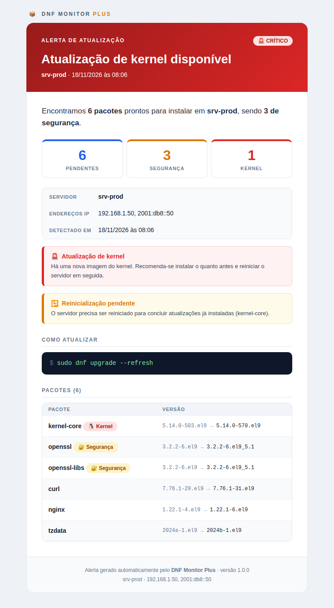
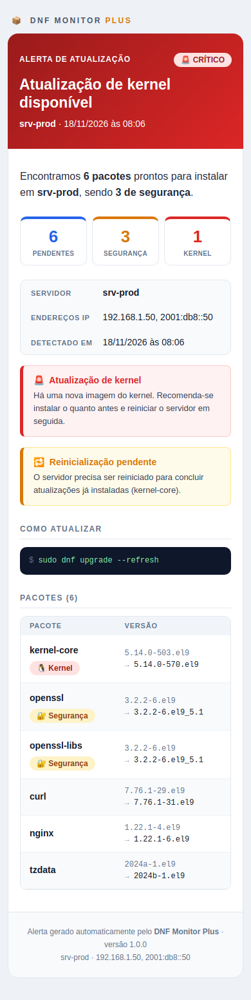
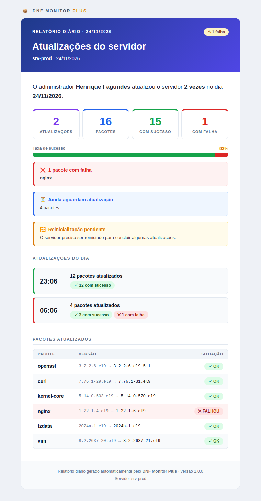
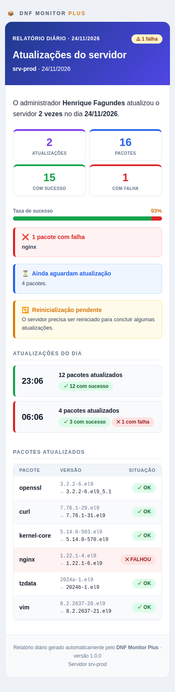
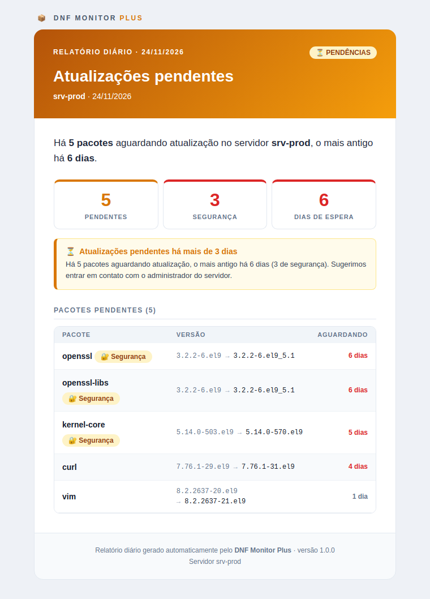
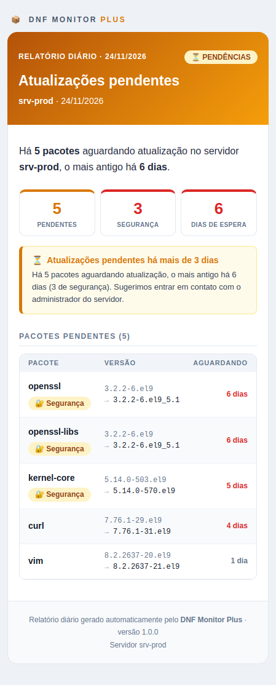

# Galeria: como são as mensagens

Capturas reais dos e-mails, geradas por um navegador (Chromium) em contêiner, no **desktop** e no **celular**. Os dados
são de exemplo. As mensagens de Telegram estão em texto, em [Catálogo de mensagens](uso.md#catálogo-de-mensagens) e em
[Relatório diário](relatorio.md#exemplos).

> Para gerar estas imagens de novo (por exemplo, depois de mexer no visual): `plus/tests/render/run.sh`.

## Para os administradores — alerta de atualização disponível

Sai **na hora**. O cabeçalho muda de cor conforme a gravidade: **vermelho** (kernel, crítico), **âmbar** (segurança)
ou **azul** (atualizações comuns). Traz cartões de totais, selos por pacote, o comando para atualizar e o horário
da detecção.

| Desktop | Celular |
|---|---|
|  |  |

Outras variantes do mesmo e-mail:

| Variante | Quando | Cabeçalho |
|---|---|---|
| Atualização de kernel | Há imagem de kernel pendente | Vermelho, selo **🚨 CRÍTICO** |
| Atualizações de segurança | Há pacote de repositório `-security` | Âmbar, selo **🔐 SEGURANÇA** |
| Atualizações disponíveis | Demais pendências | Azul, selo **📦 ATUALIZAÇÕES** |
| Lembrete | `REMINDER_DAYS` venceu | Mesma cor do nível, rótulo "Lembrete" |
| Servidor em dia | Tudo atualizado (`NOTIFY_ON_CLEAR`) | Verde, selo **✓ EM DIA** |
| Reinicialização necessária | Apareceu `reboot-required` | Âmbar, selo **🔁 REINICIAR** |

## Para o cliente — relatório diário

Um por dia. Mostra quantas vezes o administrador atualizou, os totais, a taxa de sucesso, a linha do tempo e a tabela de
pacotes.

| Desktop | Celular |
|---|---|
|  |  |

## Para o cliente — atualizações pendentes há mais de 3 dias

Quando algum pacote espera instalação há mais de `PENDING_ALERT_DAYS` dias. Lista **todos** os pendentes com a idade de
cada um e sugere falar com o administrador, sem citar nomes.

| Desktop | Celular |
|---|---|
|  |  |

## Detalhes de construção

- Layout em **tabelas com estilos inline**, que é o que Gmail, Outlook e aplicativos de celular entendem. Há um bloco
  `@media` só para melhorar telas pequenas (cartões em grade 2×2); onde ele não é suportado, o e-mail continua
  legível.
- **Sem imagens nem recursos externos**: nada é baixado ao abrir a mensagem.
- Cada e-mail vai também em **texto puro** (parte `text/plain`), para clientes que não mostram HTML.
- Há um texto de **pré-visualização** que aparece na lista da caixa de entrada (por exemplo, "4 pacotes atualizados, 3 com
  sucesso e 1 com falha").
- O `ADMIN_NAME`, nomes de pacote e hostname são **escapados**, e nunca interpretados como HTML.
